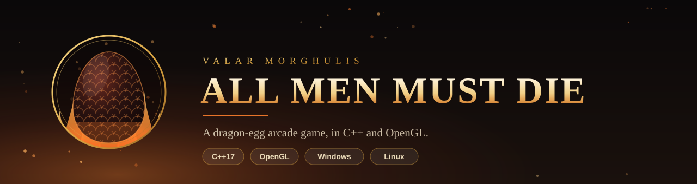
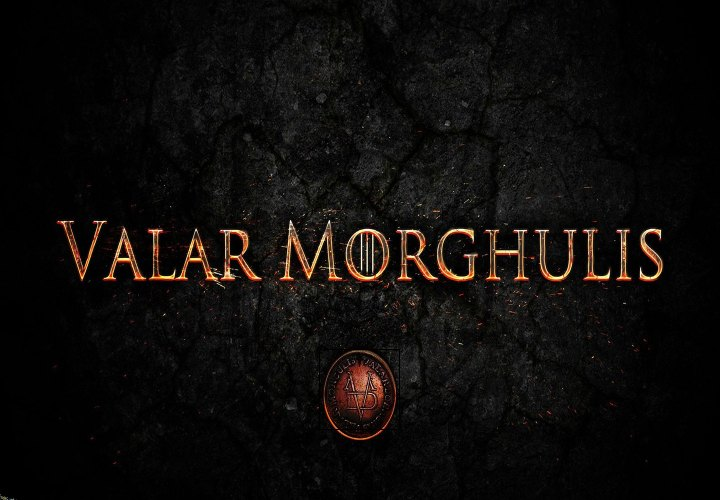
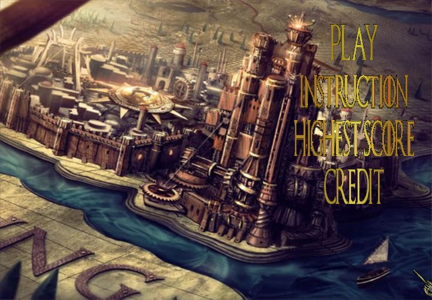
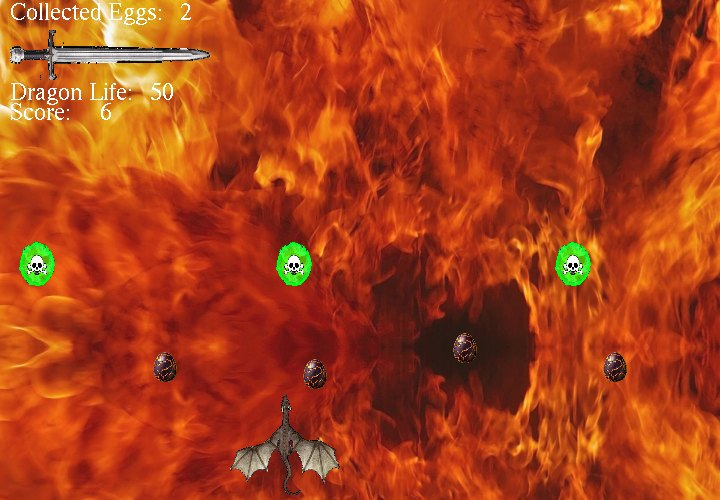
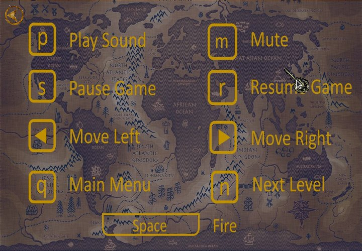
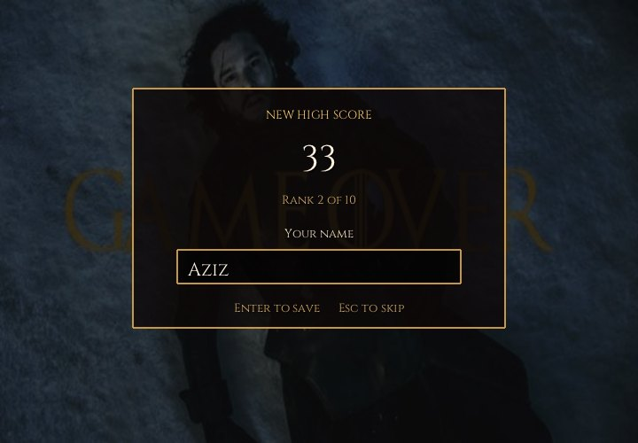
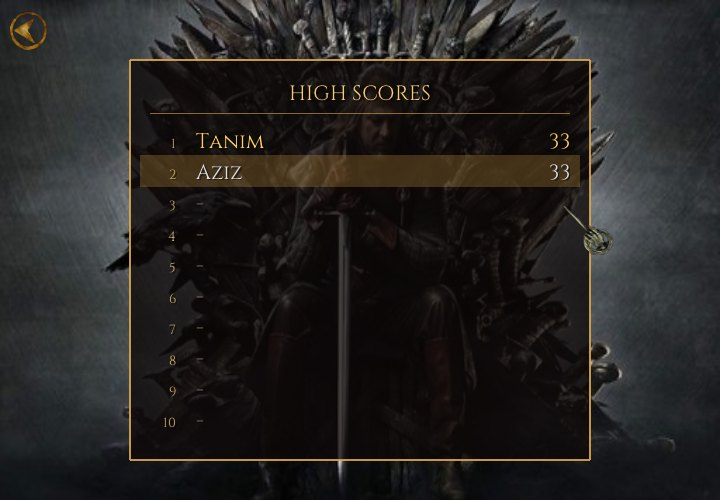
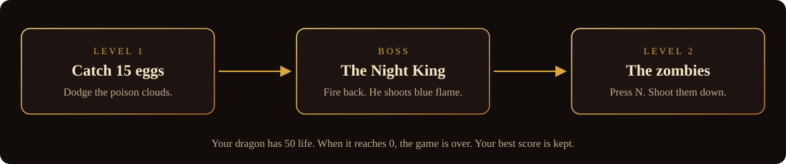

<p align="center">
  
</p>

**All Men Must Die** is a small arcade game. You are a dragon. Catch the falling dragon eggs, dodge the poison clouds, beat the Night King, then fight your way through a field of zombies.

It is a fan-made game with art from *Game of Thrones*, and the repository is named after the show's saying, *Valar Morghulis* ("all men must die"). It runs on **Windows** and **Linux**, works offline, and needs no account.

<p align="center">
  
  
  
  
  
  
</p>

## Play

Go to the [**latest release**](../../releases/latest) page. Under *Assets*, download the file for your computer.

### Windows

1. Download **all-men-must-die-windows-setup.exe**.
2. Double-click it. If Windows says *"Windows protected your PC"*, click **More info**, then **Run anyway**. (The game is open source but not signed by Microsoft, so Windows asks.)
3. Click **Next** until it finishes. Now double-click the **All Men Must Die** icon on your desktop. It is also in the Start menu.

*Don't want to install anything?* Download **all-men-must-die-windows.zip** instead, right-click it, choose **Extract All**, open the folder, and double-click **all-men-must-die**.

To remove it later: Settings, Apps, All Men Must Die, Uninstall.

### Ubuntu

1. Download **all-men-must-die-linux-amd64.deb**.
2. Double-click it, then click **Install** (it asks for your password).
3. Press the **Super** key (the Windows key), type *All Men Must Die*, and click the icon.

Or in a terminal, from the folder you downloaded it to (this also installs anything it needs):

```sh
sudo apt install ./all-men-must-die-linux-amd64.deb
```

It works on Ubuntu 20.04 or newer, 64-bit (the install is tested on 20.04, 22.04 and 24.04 on every release). Use `apt install ./file.deb` as above, not `dpkg -i`, because only `apt` fetches the libraries the game needs. To remove it: `sudo apt remove all-men-must-die`. On an older Ubuntu, build it yourself (below).

## How it goes

<p align="center">
  
</p>

| Key | What it does |
| --- | --- |
| `Left` `Right` (or `A` `D`) | Move the dragon: hold the key, it glides |
| `Space` | Fire |
| `Enter` | Start the level (after the intro), or play again (after game over) |
| `S` / `R` | Pause / resume |
| `P` / `M` | Play / mute the music and sounds |
| `N` | Go on to level 2 (after the Night King) |
| `Q` | Back to the main menu (also the **Menu** button on the game-over screen) |

The menus are used with the mouse. The top of the screen shows your eggs, life and score, and your best score so far; when the Night King comes, his life bar appears in the middle.

**High scores.** When a game ends with a score that makes the top ten, you type your name and the score is saved. The list is under *Highest Score* in the menu, and it is kept in `~/.local/share/all-men-must-die/highscores.txt` on Linux and in `%APPDATA%\AllMenMustDie\highscores.txt` on Windows.

## Build it yourself

You need CMake 3.16 or newer and a C++17 compiler.

**Ubuntu**

```sh
sudo apt install build-essential cmake freeglut3-dev
cmake -S . -B build
cmake --build build
./build/all-men-must-die
```

**Windows** (Visual Studio 2019 or newer, with the "Desktop development with C++" part)

```bat
cmake -S . -B build
cmake --build build --config Release
build\Release\all-men-must-die.exe
```

The first Windows build downloads and builds [freeglut](https://freeglut.sourceforge.net/) for you, so it needs an internet connection. You can also open the folder in Visual Studio directly (File, Open, Folder).

## What is in the folder

```
src/            the game: main.cpp (screens and input) and one header per part
                (boss, clouds, dragon eggs, zombies, score, shared variables)
src/engine/     iGraphics.h (drawing, input, timers), text, audio, file locations
src/hud.h       the score, life and boss bars, pause screen, buttons, pop-ups and sound triggers
assets/         images/, audio/ and fonts/
third_party/    stb_image, stb_truetype and miniaudio, single headers
tests/          a check of the score list (run with ctest)
tools/          scripts that made the sound effects, the HUD icons and the app icon
packaging/      the Windows icon and installer settings, and the Ubuntu .deb script
docs/           the banner, the diagram and the screenshots above
```

## About this project

This was a first university project, made in 2018 by three of us: K.M. Azizullah Tanim, Rukaiya Fahmida and Faisal Ahmmed Tonmoy. It was written for Windows and Visual Studio, on top of the `iGraphics` helper library from our course (by S. M. Shahriar Nirjon, later changed by Mohammad Saifur Rahman).

In 2026 it was cleaned up and ported, and the game itself was left as it was. What changed:

- **Runs on Linux as well as Windows.** The Windows-only parts were replaced: `SetTimer` with GLUT timers, `PlaySound` with miniaudio, the old Glaux image loader with stb_image, and the 2018 GLUT with freeglut.
- **Easy to install.** A setup program for Windows and a `.deb` for Ubuntu, each with an icon you can click; the `.exe` carries the game's icon. A GitHub Actions workflow builds them, and runs the score test.
- **You can play again.** The game-over and level-complete screens have **Play again**, **Next level** and **Menu** buttons. Before, they had none, and the only way out was a key (`Q`) that the screen never mentioned.
- **Feels better to play.** The dragon glides while a key is held (before, it jumped 10 pixels per key-repeat event). Pictures have soft, smooth edges, and the system mouse pointer is hidden. Hits flash the screen red and shake it a little, caught eggs and hits pop up their points, and **S** now shows a pause screen.
- **A proper HUD.** The white Times text became Cinzel with icons: an egg counter, a heart for life, a star for score, a skull and bar for the Night King.
- **Sound effects.** Six short sounds (egg, fire, hit, hurt, win, lose) are generated by `tools/make_sfx.py`, so they carry no licence. They are played by watching the game's numbers change, so the game logic did not need to be touched.
- **A top-ten list with names.** Before, only one number was kept.
- **25 MB of art became 3.6 MB.** Pictures were scaled to the size the 720 by 500 window can show, and the 22 MB WAV music file became a 2 MB MP3. 28 pictures the game never used were removed.
- **No build output or copied libraries in the repository.** The old Visual Studio project, `.exe`, `.pdb` and bundled GLUT files are gone; the history still has them.

One oddity is kept on purpose: three checks in the boss code compared the text buffer of the boss's life to zero (`bossLife>0`), which is always true. They are now removed, so the game plays exactly as it did.

## Credits and legal

- The pictures (stills and fan art, mostly from *Game of Thrones*) and the music are not mine to license, and are used here for learning. This project is not connected to HBO or the show's makers. If you own something here and want it removed, open an issue.
- [stb_image](https://github.com/nothings/stb) (public domain) and [miniaudio](https://github.com/mackron/miniaudio) (public domain or MIT-0) are included in `third_party/`. [freeglut](https://freeglut.sourceforge.net/) (MIT-style) is used as a library. The text is set in [Cinzel](https://github.com/NDISCOVER/Cinzel) (SIL Open Font License, copied to `assets/fonts/OFL.txt`).
