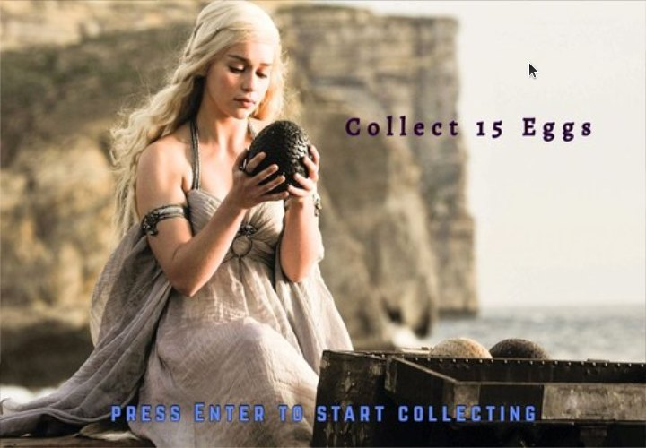

<p align="center">
  
</p>

**All Men Must Die** is a small arcade game. You are a dragon. Catch the falling dragon eggs, dodge the poison clouds, beat the Night King, then fight your way through a field of zombies.

It is a fan-made game with art from *Game of Thrones*, and the repository is named after the show's saying, *Valar Morghulis* ("all men must die"). It runs on **Windows** and **Linux**, works offline, and needs no account.

<p align="center">
  
  
  
  
</p>

## Play

Download the zip (Windows) or tar.gz (Linux) from the [latest release](../../releases/latest), unpack it, and run `all-men-must-die`.

The Linux download is for Ubuntu 22.04 or newer. On older versions, build it yourself (below). First install the one library the game needs:

```sh
sudo apt install freeglut3
```

## How it goes

<p align="center">
  
</p>

| Key | What it does |
| --- | --- |
| `Left` `Right` | Move the dragon |
| `Space` | Fire |
| `Enter` | Start the level (after the intro) |
| `S` / `R` | Pause / resume |
| `P` / `M` | Play / mute the music |
| `N` | Go on to level 2 (after the Night King) |
| `Q` | Back to the main menu |

The menus are used with the mouse. Your best score is saved in `~/.local/share/all-men-must-die/` on Linux and in `%APPDATA%\AllMenMustDie\` on Windows.

## Build it yourself

You need CMake 3.16 or newer and a C++17 compiler.

**Ubuntu**

```sh
sudo apt install build-essential cmake freeglut3-dev
cmake -S . -B build
cmake --build build
./build/all-men-must-die
```

**Windows** (Visual Studio 2019 or newer, with the "Desktop development with C++" part)

```bat
cmake -S . -B build
cmake --build build --config Release
build\Release\all-men-must-die.exe
```

The first Windows build downloads and builds [freeglut](https://freeglut.sourceforge.net/) for you, so it needs an internet connection. You can also open the folder in Visual Studio directly (File, Open, Folder).

## What is in the folder

```
src/            the game: main.cpp (screens and input) and one header per part
                (boss, clouds, dragon eggs, zombies, score, shared variables)
src/engine/     iGraphics.h (drawing, input, timers), audio, file locations
assets/         images/ and audio/
third_party/    stb_image (image loading) and miniaudio (music), single headers
docs/           the banner, the diagram and the screenshots above
```

## About this project

This was a first university project, made in 2018 by three of us: K.M. Azizullah Tanim, Rukaiya Fahmida and Faisal Ahmmed Tonmoy. It was written for Windows and Visual Studio, on top of the `iGraphics` helper library from our course (by S. M. Shahriar Nirjon, later changed by Mohammad Saifur Rahman).

In 2026 it was cleaned up and ported, and the game itself was left as it was. What changed:

- **Runs on Linux as well as Windows.** The Windows-only parts were replaced: `SetTimer` with GLUT timers, `PlaySound` with miniaudio, the old Glaux image loader with stb_image, and the 2018 GLUT with freeglut.
- **Built with CMake**, with a GitHub Actions workflow that builds both versions.
- **25 MB of art became 3.6 MB.** Pictures were scaled to the size the 720 by 500 window can show, and the 22 MB WAV music file became a 2 MB MP3. 28 pictures the game never used were removed.
- **The best score is now kept properly.** Before, a new session started from zero and could overwrite a higher saved score, and the file was written next to the program.
- **No build output or copied libraries in the repository.** The old Visual Studio project, `.exe`, `.pdb` and bundled GLUT files are gone; the history still has them.

One oddity is kept on purpose: three checks in the boss code compared the text buffer of the boss's life to zero (`bossLife>0`), which is always true. They are now removed, so the game plays exactly as it did.

## Credits and legal

- The pictures (stills and fan art, mostly from *Game of Thrones*) and the music are not mine to license, and are used here for learning. This project is not connected to HBO or the show's makers. If you own something here and want it removed, open an issue.
- [stb_image](https://github.com/nothings/stb) (public domain) and [miniaudio](https://github.com/mackron/miniaudio) (public domain or MIT-0) are included in `third_party/`. [freeglut](https://freeglut.sourceforge.net/) (MIT-style) is used as a library.
